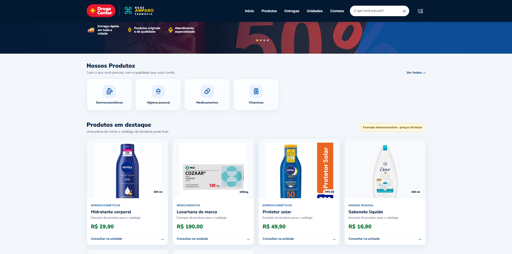
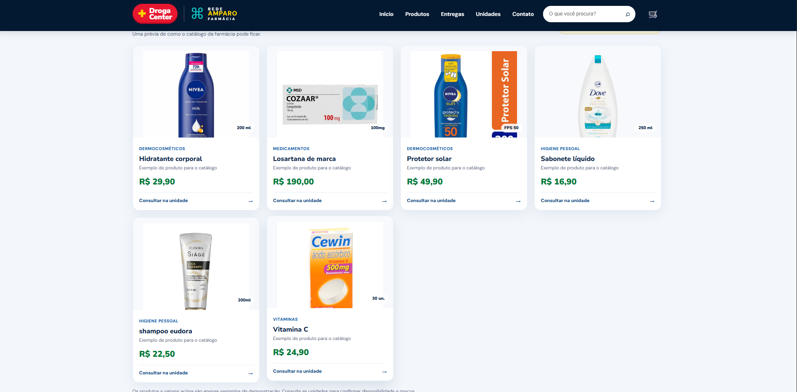
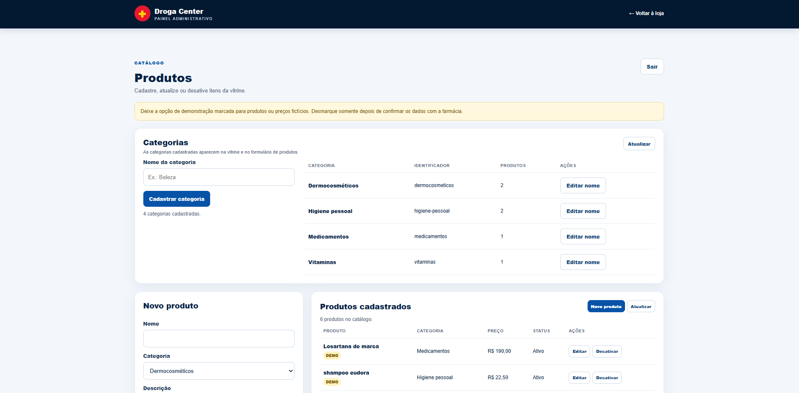
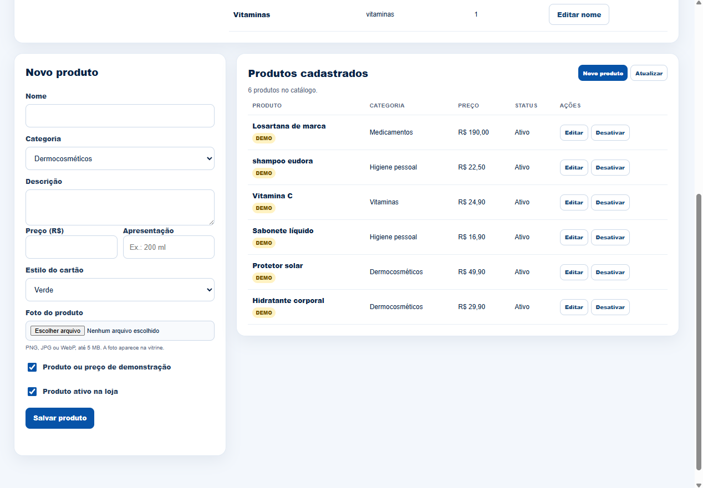
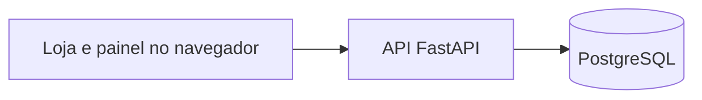

# Droga Center + Rede Amparo

Aplicação web de portfólio para apresentar uma rede de farmácias e gerenciar seu catálogo. O projeto reúne uma vitrine responsiva, uma API REST em Python e um painel administrativo conectado ao PostgreSQL.

> **Em desenvolvimento:** produtos e preços iniciais são fictícios e estão marcados como demonstração. O projeto ainda não representa um catálogo comercial oficial.

## Funcionalidades

- Vitrine responsiva com categorias e produtos carregados da API.
- Busca por produtos e categorias, sem diferenciar acentos.
- Painel administrativo com login para cadastrar, editar e desativar produtos.
- Cadastro e edição de categorias pelo painel; novas categorias aparecem na vitrine.
- Upload de fotos de produtos em PNG, JPG ou WebP pelo painel, com limite de 5 MB.
- API REST para consultar o catálogo e gerenciar produtos e categorias.
- PostgreSQL com relacionamento entre produtos e categorias.
- Desativação lógica de produtos, preservando o registro no banco.

## Capturas da aplicação

### Loja e categorias



### Catálogo de produtos



### Painel administrativo



### Cadastro e lista de produtos



## Arquitetura



## Tecnologias

| Camada | Tecnologias |
| --- | --- |
| Front-end | HTML5, CSS3 e JavaScript |
| API | Python, FastAPI e Psycopg 3 |
| Banco de dados | PostgreSQL |
| Sessão administrativa | Cookie assinado, `HttpOnly` e `SameSite=Strict` |

## Executar localmente

Você precisa de Python e PostgreSQL. O pgAdmin pode ser usado para criar o banco; não é necessário ter `psql` no PATH.

1. No pgAdmin, crie um banco chamado `farmacia`.
2. Na pasta do projeto, copie o modelo de configuração e abra o `.env`:

   ```powershell
   Copy-Item .env.example .env
   notepad .env
   ```

3. Preencha `DATABASE_URL` com os dados do seu PostgreSQL. Escolha um usuário e uma senha próprios para o painel em `ADMIN_USERNAME` e `ADMIN_PASSWORD`. Gere um segredo para `SESSION_SECRET` com:

   ```powershell
   python -c "import secrets; print(secrets.token_urlsafe(48))"
   ```

   Cole o valor gerado em `SESSION_SECRET`. Não use a senha do PostgreSQL como senha do painel. Se a senha do banco contiver `@`, escreva `%40` no lugar desse caractere dentro da URL.

4. Crie o ambiente virtual, instale as dependências e inicie o servidor:

   ```powershell
   python -m venv .venv
   .\.venv\Scripts\Activate.ps1
   pip install -r requirements.txt
   python -m uvicorn app:app --port 8001
   ```

   Mantenha o terminal aberto enquanto usa o site. Para parar o servidor, pressione **Ctrl + C**.

5. Abra no navegador:

   - Loja: <http://127.0.0.1:8001>
   - Painel administrativo: <http://127.0.0.1:8001/admin>
   - Documentação interativa da API: <http://127.0.0.1:8001/docs>
   - Saúde da API: <http://127.0.0.1:8001/api/health>

Na primeira execução, o servidor cria as tabelas `categories` e `products`. Se a tabela de produtos estiver vazia, insere quatro registros fictícios para demonstrar a vitrine.

## Principais rotas da API

| Método | Rota | Acesso | Descrição |
| --- | --- | --- | --- |
| `GET` | `/api/health` | Público | Verifica a conexão com o banco. |
| `GET` | `/api/categories` | Público | Lista categorias e contagem de produtos ativos. |
| `GET` | `/api/products` | Público | Lista produtos ativos. |
| `GET` | `/api/products?q=solar` | Público | Busca por texto. |
| `POST` | `/api/admin/login` | Público | Inicia uma sessão administrativa. |
| `GET` | `/api/admin/products` | Login | Lista produtos para o painel. |
| `POST` | `/api/admin/products` | Login | Cadastra um produto. |
| `PUT` | `/api/admin/products/{slug}` | Login | Edita um produto. |
| `POST` | `/api/admin/products/{slug}/image` | Login | Envia ou substitui a foto de um produto. |
| `DELETE` | `/api/admin/products/{slug}/image` | Login | Remove a foto de um produto. |
| `DELETE` | `/api/admin/products/{slug}` | Login | Desativa um produto sem apagá-lo. |
| `POST` | `/api/admin/categories` | Login | Cadastra uma categoria. |
| `PUT` | `/api/admin/categories/{slug}` | Login | Edita o nome de uma categoria. |

## Estrutura do projeto

```text
├── app.py                 # API FastAPI e acesso ao PostgreSQL
├── admin.html             # Painel administrativo
├── admin.js               # Login e gerenciamento do catálogo
├── admin.css              # Estilos do painel
├── assets/                # Imagens locais e fotos enviadas pelo painel
├── index.html             # Vitrine
├── script.js              # Busca e integração com a API
├── style.css              # Estilos da vitrine
├── requirements.txt       # Dependências Python
├── .env.example           # Modelo de configuração local
└── .gitignore             # Arquivos que não devem ir ao GitHub
```

## Escopo atual

- O catálogo usa dados demonstrativos; produtos, preços e disponibilidade reais precisam ser confirmados.
- O número oficial de WhatsApp ainda não foi configurado.
- O painel usa um único usuário e senha definidos no `.env`.
- O projeto ainda não está publicado e não inclui checkout ou pagamento.

Antes de publicar, configure HTTPS e `COOKIE_SECURE=true`, proteja as tentativas de login e defina backups para o PostgreSQL. O GitHub Pages sozinho não executa a API nem hospeda o banco.

## Cuidados com credenciais e dados

O `.gitignore` exclui `.env`, `.venv`, `.vscode` e o antigo arquivo SQLite `Farmacia.db`. O `.env.example` contém apenas valores de exemplo e deve ser enviado ao repositório; o `.env` real não. Não publique senhas, tokens, cópias do banco ou dados privados de clientes.
